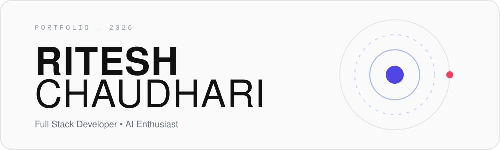

<div align="center">



<a href="https://github.com/rc-3261"></a>

<br/>


</div>


## 👨‍💻 About Me

```python
class Developer:
    def __init__(self):
        self.name = "Ritesh"
        self.github = "rc-3261"
        self.languages = ["Python", "JavaScript", "TypeScript"]
        self.focus = ["Web Development", "AI / ML", "Backend APIs"]
        self.currently = "Learning, building & contributing"

    def say_hi(self):
        print("Thanks for stopping by! Let's build something great 🚀")

Developer().say_hi()
```

- 🔭 Working on projects that blend **web development** and **AI**
- 🌱 Constantly improving my skills in **Python, React & cloud (AWS)**
- 🤝 Open to **collaborations** and **open-source contributions**
- 💬 Ask me about **Django, FastAPI, React or PyTorch**
- ⚡ Fun fact: I debug with `print()` and I'm not ashamed


## 🚀 Languages

<p align="center">
  
</p>

## 🧩 Frameworks & Libraries

<p align="center">
  
</p>

## 🛠️ Tools & Platforms

<p align="center">
  
</p>


## 📊 GitHub Stats

<div align="center">


</div>


## 🌐 Let's Connect

<p align="center">
  <a href="https://github.com/rc-3261"></a>
  <a href="https://www.instagram.com/ritesh_8080__"></a>
</p>

<div align="center">

Thank you for taking the time to explore my work and projects. Your interest is truly appreciated.
If you have questions, suggestions, or ideas for collaboration, don't hesitate to reach out.
I'm always open to connecting with fellow developers, sharing knowledge, and contributing to meaningful projects.


⭐ *If you like what you see, drop a star on a repo!* ⭐

</div>


