 

  

<h2 id="about" align="center">🧑‍💻 About</h2>

  

 

<h2 id="skills" align="center">⚡ Skills</h2>

  
    
  

 

<h2 id="stats" align="center">📊 Stats</h2>

<table>
  <tr>
    <td align="center">
      
    </td>
    <td align="center">
      
    </td>
  </tr>
  <tr>
    <td colspan="2" align="center">
      
    </td>
  </tr>
</table>

 

<h2 id="projects" align="center">🚀 Projects</h2>

<!-- Replace YOUR-REPO-1 / 2 / 3 / 4 with your real repository names -->

<table>
  <tr>
    <td></td>
    <td></td>
  </tr>
  <tr>
    <td></td>
    <td></td>
  </tr>
</table>

 

<h2 id="connect" align="center">🌐 Connect</h2>

  
  
  <!-- Optional: remove the comment markers and add your details
  
  
  -->

Thank you for taking the time to explore my work and projects. If you have questions, suggestions, or ideas for collaboration, please reach out. I'm always happy to connect with fellow developers, share knowledge, and contribute to meaningful projects.

  

